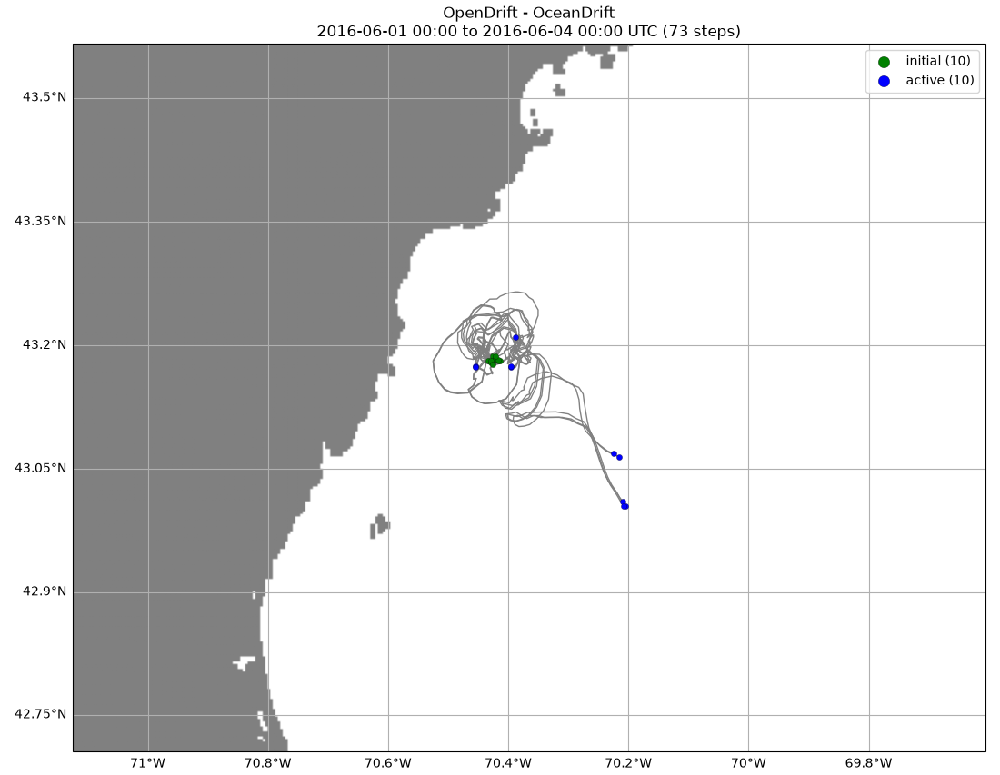
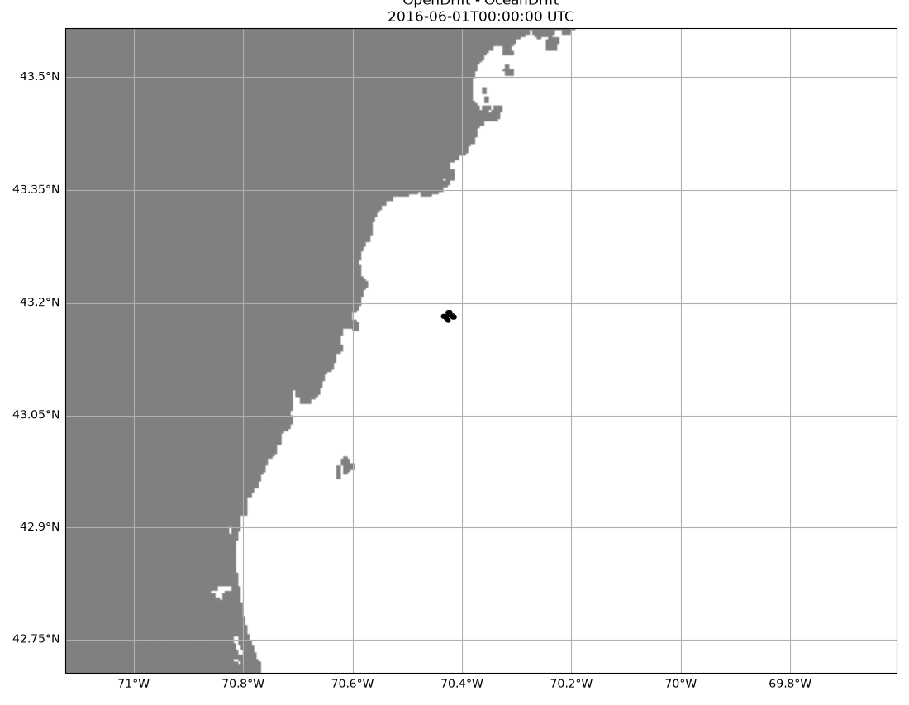

# opendrift-fvcom

Run [OpenDrift](https://opendrift.github.io/) particle-tracking simulations
directly against FVCOM unstructured-grid ocean model output served from an
[Icechunk](https://icechunk.io) virtual store, with no local copy of the
source NetCDF files.

OpenDrift ships readers for FVCOM, but they expect to open their own
zarr/netCDF files and assume a 1-D sigma-layer coordinate. `fvcom_icechunk_reader.py`
instead takes an already-opened (and ideally already time-windowed, already
`.load()`-ed) `xarray.Dataset` and reads currents straight off its native
`lon`/`lat`/`lonc`/`latc` geographic coordinates, which sidesteps:

- the dataset's Cartesian (NAD83 state-plane) grid projection, and
- a 2-D `(siglay, node)` sigma coordinate that the stock readers don't
  handle.

It currently supports surface (single sigma-layer) currents only
(`x_sea_water_velocity` / `y_sea_water_velocity`), suitable for 2-D /
near-surface drift simulations.

## Example

`run_buoy_b_example.py` runs a 3-day surface-drift simulation using the
[UMASSD FVCOM GOM3 hindcast](https://github.com/opensciencecomputing/umassd-fvcom),
releasing a 10-particle cluster at the NERACOOS Buoy B01 (Western Maine
Shelf, 43.1807N 70.4278W) location on 2016-06-01 00:00 UTC and tracking it
through 2016-06-04 00:00 UTC:

```bash
pip install -r requirements.txt
python run_buoy_b_example.py
```

The first run streams ~70 MB of surface `u`/`v` for the 3-day window
anonymously from the public `s3://umassd-fvcom` bucket (takes roughly a
minute) and caches it to `output/surface_uv_cache.nc` so subsequent runs
are instant. Trajectories, a plot, and an animation are written to
`output/`.





All 10 particles stayed in open water for the full 3 days (no stranding);
net displacement after 3 days ranged from about 2 km to 27 km across the
cluster, with the local tidal ellipse near the buoy clearly visible.

## Using with another Icechunk / FVCOM store

```python
import xarray as xr
from fvcom_icechunk_reader import Reader

# ds: an xarray.Dataset with data_vars u, v of shape (time, nele)
# (a single sigma layer already selected) and coordinates
# lon/lat (node), lonc/latc (nele) - load it into memory first for speed.
reader = Reader(ds, name='my-fvcom-reader')

from opendrift.models.oceandrift import OceanDrift
o = OceanDrift()
o.add_reader(reader)
o.set_config('drift:vertical_mixing', False)  # surface currents only
o.seed_elements(lon=..., lat=..., radius=500, number=10, z=0, time=...)
o.run(end_time=..., time_step=3600)
```
